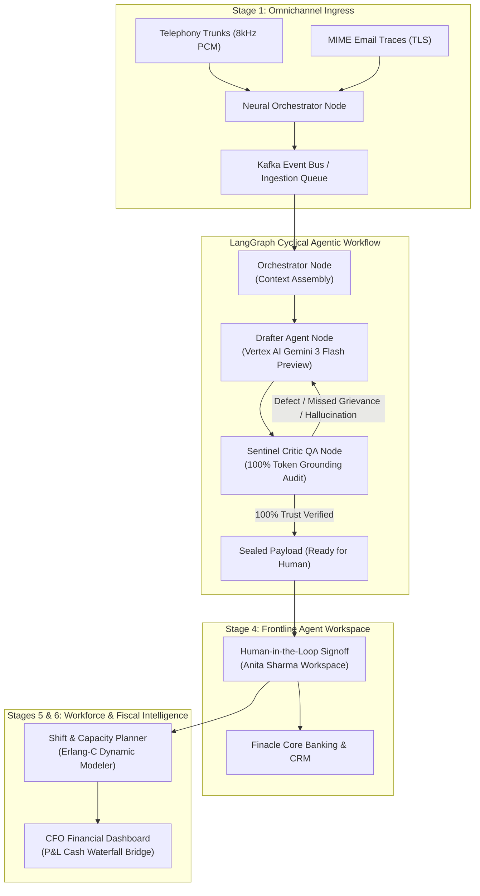

# OmniStream Sentinel

> **Agentic AI Contact Center Intelligence & Hallucination Guardrail for Retail Banking**  
> Built with FastAPI, LangGraph, Google Cloud Vertex AI (Gemini 3 Flash Preview), and React 18+ (Vite, Tailwind CSS, Zustand). Fully Dockerized for Google Cloud Run via GitHub Actions.

---

## 🏛️ Executive Summary & Mission

**OmniStream Sentinel** is an enterprise-grade agentic AI platform designed for retail banks to solve the critical "Adoption Roadblock" in generative AI deployments: **regulatory liability and hallucinations**.

While basic generative models can draft customer interaction notes, banks historically stalled at **35% frontline adoption** because agents and compliance officers could not risk ungrounded promises, missed statutory complaints (e.g., RBI Ombudsman filings), or inaccurate transaction data entering core banking ledgers.

OmniStream Sentinel pairs a **Drafter Agent** with an adversarial **Sentinel Critic QA Agent** inside a **cyclical LangGraph workflow**:
1. **Drafter Agent**: Extracts customer intent, structured action items, and emotional trajectories.
2. **Sentinel Critic QA Agent**: Independently reverse-indexes candidate summaries against raw acoustic audio and encrypted MIME email transcripts to enforce 100% token grounding. If complaints are missed or hallucinations are detected, it **loops back to the Drafter with corrective instructions**.
3. **CFO Financial Engine**: Bridges theoretical capacity (4,280 hours freed across 256,800 cases) into verified, audited hard cash savings (₹84 Lakhs/month) on the general ledger.

---

## 📐 System Architecture



---

## 🖥️ The 6 Core Enterprise Screens

All screens strictly adhere to the First Heritage Financial design system:

| # | Screen | Source Design | Key Functional Capabilities |
|---|---|---|---|
| **1** | **Omnichannel Intake** | `omnichannel_intake_routing` | Dual-stream ingestion (telephony SIP & MIME email), Kafka event bus, 3-column stream pipeline, live packet telemetry, on-demand payload ingestion. |
| **2** | **AI Summarizer** | `the_ai_summarizer_drafter_agent` | 50/50 split workstation: Diarized audio transcript + interactive waveform scrubber vs. AI Drafter output with violet accent `#7c3aed`, intent extraction, 4 auto-executions synced, and tone trajectory (-78 to +64). |
| **3** | **Critic Agent QA** | `the_trust_guardrail_sentinel_critic` | Deep Deterministic Audit: 100% Trust score badge, 3 hard-satisfied compliance rules, laser-scanning beam, dual-column mutual cross-referencing provenance, speculative audit tree, cyclic override trigger. |
| **4** | **Agent Workspace** | `agent_workspace_human_in_the_loop` | Frontline workspace: Review stopwatch, immediate shadow credit remediation card (₹14,250 Apollo Pharmacy UPI dispute), single-click dispatch to Finacle CRM, gamified capacity tracker (+60s saved), and Customer 360 dossier with TRV (₹48.5L). |
| **5** | **Shift & Capacity Planner** | `shift_capacity_planner` | Workforce reallocation: 4,280 hours freed across 5 regional hubs (Mumbai, Bengaluru, Delhi NCR, Chennai, Pune), interactive Erlang-C staffing slider (48-54 agents), 24-hr shift distribution bars, and P&L cash unlock pill (₹14.2L/mo). |
| **6** | **CFO Financial Dashboard** | `the_cfo_financial_dashboard` | Executive capital briefing: 95.2% adoption roadblock overcome, Liquidity Bridge (₹1.12 Cr gross potential $\to$ ₹0.84 Cr hard cash realized), monospace KPI tiles, custom SVG P&L waterfall chart, and statutory compliance ledger modal. |

---

## 🤖 Agentic Engine & Vertex AI Implementation

### LangGraph Cyclical Pipeline
Implemented in `backend/app/graph/workflow.py`:
- **StateGraph**: Maintains conversational transcripts, intent, actions, and verification audit logs.
- **Conditional Edge**: `route_critic_decision` checks `state["critic_approved"]`. If `False`, routes back to `drafter` with explicit `critic_feedback`. If `True`, completes to `END`.
- **Real-Time Streaming**: Server-Sent Events (SSE) via `/api/stream/{interaction_id}` emit phase-by-phase state updates to the React frontend.

### Vertex AI Gemini 3 Flash Preview
- Connected to Google Cloud Vertex AI via the modern Google GenAI SDK.
- Model: `gemini-3-flash-preview` (configurable via `VERTEX_MODEL`).
- Embeddings: Strictly configured for `gemini-embedding-001`.
- Deterministic banking domain fallback included for local test environments without active GCP service credentials.

---

## 🗄️ Database Architecture (SQLModel & Async SQLite)

Configured for ephemeral Cloud Run container lifecycles:
- **Path**: `sqlite+aiosqlite:////tmp/omnistream.db` (ephemeral container filesystem).
- **Tables**:
  - `interactions`: `id`, `channel`, `customer_name`, `customer_cif`, `raw_transcript`, `status` (`Processing`, `QA_Failed`, `Ready_for_Human`, `Completed`), timestamps.
  - `summaries`: `id`, `interaction_id`, `generated_text`, `intent`, `key_actions_json`, `sentiment_data_json`, `hallucinations_detected`, `critic_approved`, `critic_feedback`, `iteration_count`.
  - `system_telemetry`: `id`, `total_interactions`, `human_adoptions`, `capacity_freed_seconds`, `hours_freed`, `hard_savings_inr`, `soft_capacity_inr`, `ai_run_cost_inr`, `cost_to_serve_inr`, `payback_period_months`, `roi_multiple`.

---

## 🐳 Dockerization (Single-Container Architecture)

Multi-stage `Dockerfile`:
- **Stage 1 (Frontend Builder)**: Node.js 20 builds the React Vite application into optimized static assets (`dist/`).
- **Stage 2 (Runtime Container)**: Python 3.12 installs `uv` and backend dependencies, copies the compiled static frontend to `/app/static` and mounts it to `/` in FastAPI, and exposes port `8080`.

---

## 🚀 CI/CD Pipeline (GitHub Actions to Google Cloud Run)

Located at `.github/workflows/deploy.yml`:
- **GCP Project ID**: `slabspro-slabsuser37`
- **Region**: `asia-south1`
- **Artifact Registry Repo**: `omnistream-repo`
- **Cloud Run Service Name**: `omnistream-sentinel`
- **Authentication**: `google-github-actions/auth@v2` with `secrets.GCP_CREDENTIALS`.
- **Flags**: `--allow-unauthenticated --port=8080 --memory=2Gi --cpu=2`.

---

## 💻 Local Development Setup

### 1. Backend Setup (Python 3.12 with uv)
```bash
cd backend
uv sync --all-extras
uv run pytest -v
uv run uvicorn app.main:app --host 0.0.0.0 --port 8080 --reload
```

### 2. Frontend Setup (React 18+ Vite)
```bash
cd frontend
npm install
npm run build
npm run dev
```

### 3. Run Single Container via Docker
```bash
docker build -t omnistream-sentinel:latest .
docker run -p 8080:8080 -e GCP_PROJECT=slabspro-slabsuser37 -e GCP_REGION=asia-south1 omnistream-sentinel:latest
```
Visit: `http://localhost:8080`
API Documentation: `http://localhost:8080/docs`
